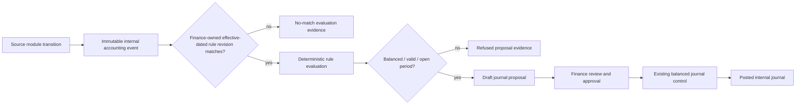

# Accounting Event → Posting Rule → Journal Proposal Control Design

> **Implementation status:** The first bounded non-payroll procurement-receipt control is implemented. It emits immutable internal events, evaluates approved effective-dated finance rules, and creates human-reviewed journal proposals only. It does **not** activate automatic posting, create or post an authoritative journal, execute payments, transmit data externally, or make payroll/tax/compliance determinations.

## 0. First implementation status

Migration `0017_condemned_leper_queen.sql` adds tenant-scoped immutable accounting events, finance-owned effective-dated posting-rule revisions, and journal proposals. A final internal purchase-order receipt emits a `procurement_receipt` event with source, inventory-movement, period, currency, dimension, and evidence snapshots. One approved effective-dated deterministic debit/credit rule may yield a balanced `pending_review` proposal; zero or multiple matching rules yield durable refusal evidence.

The implemented initial selector vocabulary is intentionally narrower than the target design: exactly one literal active debit account and one literal active credit account, each using the retained functional event amount. A finance reviewer can approve or reject a proposal, but no proposal converts into, creates, or posts an `erp_journals` record. Future selector types, multi-line splits, valuation policy, and conversion must remain separately governed increments.

## 0.1 Finance-dimension catalog foundation

Migration `0018_awesome_naoko.sql` adds tenant-scoped finance-dimension definitions and dimension values. Finance-authorized users can create a draft dimension definition, activate it, create a draft value only under an active definition, and activate that value. The catalog is deliberately generic: it provides configuration vocabulary and lifecycle evidence for dimensions such as cost center, profit center, department, project, warehouse, or contract, but it does not assign statutory semantics, infer values, alter existing event snapshots, enforce a dimension on a proposal, or post a journal.

Each definition and value is unique in its active venture, carries a draft/active/retired lifecycle, and creates internal audit evidence with explicit no-automatic-posting and no-external-effect flags. Required-dimension enforcement and selector binding remain future governed increments after finance policy is configured.

Journal Control now exposes the finance-owned catalog over the existing tenant-scoped contracts. Finance-authorized users can create draft definitions, opt into `requiredForProposal`, activate a non-retired definition, create draft values only under an active definition, and activate a non-retired value. The interface shows the retained lifecycle and value register, but it has no control to infer a source value, rewrite an event/proposal snapshot, create a journal, or post one. Activating a required definition remains a forward-looking refusal guard: a future proposal without the relevant retained source value is refused rather than populated from this catalog.

## 0.2 Frozen proposal-dimension snapshots

When the engine evaluates an event, it reads the active finance-dimension definitions for the same venture and freezes a catalog snapshot into the proposal. Every generated line receives the same immutable context: tenant, source event, source document snapshot, source dimensions, evidence references, posting-rule code/revision, effective date, period, currency, and the active finance-dimension catalog with retained source values. A later rename, retirement, value change, or catalog restructure cannot alter the persisted proposal snapshot.

An active definition marked `requiredForProposal` is a guard, not a defaulting mechanism. If its code has no retained source value on the accounting event, evaluation produces durable refusal evidence rather than inferring a value, selecting the first active value, or creating a journal. Existing snapshots remain immutable; this increment does not retroactively alter them.

## 0.3 Bounded deterministic allocations

The initial proposal engine now supports one or more debit percentage allocations and one balancing credit, expressed in integer basis points. Debit percentages and the credit percentage must each total exactly 10,000 basis points. The evaluator calculates to two decimal places, applies any rounding residual deterministically to the final debit allocation, and persists the percentage, total cents, residual treatment, and frozen context on every proposal line. Existing one-debit/one-credit rule snapshots without an explicit percentage remain compatible as 100.00% mappings.

Journal Control now exposes this existing bounded vocabulary directly to finance-authorized users. Its rule editor lets finance add or remove debit allocation lines, select a tenant chart-of-accounts master, state an integer basis-point allocation and line narrative, and see the live debit total against 10,000 basis points. It will not submit unless every line is complete, the debit total is exactly 10,000, and no debit allocation reuses the balancing credit account. The server repeats the balancing-credit account guard and continues to validate active same-tenant accounts and exact percentage totals; the UI is not a substitute for those controls.

The rule register now also renders the retained `lineConfiguration` and source requirements from every revision as a read-only explanation surface. It identifies debit/credit side, selected account, basis points, narrative, and retained source requirements exactly as stored in the revision. The surface has no edit action: a material policy change still requires a new finance-owned revision, while proposal conversion and journal posting remain absent from this control engine.

This is intentionally not a valuation, landed-cost, weight, volume, driver, cost-pool, fixed-amount, quantity, or labor/machine-hour allocation engine. Those allocation types require separate finance policy, source-data contracts, and controlled tests before adoption. No allocation creates or posts a journal, changes balances, calculates tax/payroll, issues a payment, files, or transmits externally.

## 0.4 Read-only ledger-simulation design

The companion `READ-ONLY-LEDGER-SIMULATION-DESIGN.md` defines the next safe preview layer. It consumes only immutable accounting-event, rule, proposal, and dimension snapshots; returns an explainable ephemeral result; and refuses incomplete, cross-tenant, unapproved, mixed-currency, or unbalanced inputs. It is intentionally separate from journal creation and posting.

## 0.5 Immutable calculation evidence and tamper-evident verification

Migration `0019_handy_bromley.sql` adds `erp_accounting_calculation_evidence`, an append-only, tenant-scoped calculation record for the bounded procurement-receipt calculation. A finance-authorized user may explicitly request evidence separately from **Simulate only**. The service freezes calculation inputs and outputs, recursively canonicalizes object keys, and calculates SHA-256 `inputHash`, `outputHash`, and `recordHash`; the latter includes the preceding evidence record hash, calculation key, engine version, and status. The first record has a `null` predecessor, while each later record retains the immediately preceding venture record hash.

The stored invariant snapshot is independently derived from the generated lines rather than copied from the simulation balancing flag. It checks debit-versus-credit cents, debit and credit allocation totals of 10,000 basis points, debit cents against retained source cents, and the presence of a deterministic final-debit residual explanation. Read-only verification rehashes stored snapshots, replays record-hash predecessor links in ID order, recomputes the independent invariants, and returns a per-record pass/fail posture. It does not update evidence or calculate any statutory, payroll, tax, payment, inventory-valuation, filing, workflow, integration, or external result.

The Journal Control interface makes the distinction visible: **Simulate only** remains a metadata-audited in-memory preview; **Calculate immutable evidence** retains one tenant-scoped evidence record keyed to the deterministic simulation; the evidence register exposes retained record hashes, predecessor hashes, review status, and a read-only chain-verification posture. Neither action creates, converts, posts, or numbers a journal.

## 1. Purpose and boundary

This design adds a controlled seam between an operational fact and a finance-reviewed journal. A source module emits an **immutable internal accounting event**. A finance-owned, effective-dated posting-rule revision may evaluate that event into a **balanced journal proposal**. The proposal is separate from the authoritative journal and cannot post itself. Existing finance authorization, period controls, balanced-journal validation, and audit evidence remain the only path to a posted journal.

| Stage | Owner | Durable output | Prohibited behavior |
|---|---|---|---|
| Operational event emission | Source bounded context | Immutable accounting event | Direct journal write, external transmission, legal/tax conclusion |
| Rule authoring/review | Finance | Effective-dated approved rule revision | Unreviewed activation or executable arbitrary code |
| Evaluation | Control engine | Journal proposal or refusal evidence | Automatic posting, payment, filing, supplier/customer message |
| Proposal approval | Finance | Approval decision and existing journal draft linkage | Bypass of period close, balance, role, or approval controls |
| Journal posting | Existing journal control | Posted journal and audit trail | Reversal/deletion of immutable source event |

The first implementation increment is intentionally limited to **internal accounting evidence and journal proposals**. It does not implement a statutory tax engine, financial statements, consolidation, cost allocations, inventory valuation, revenue recognition, treasury, investment accounting, or any posting rule that the venture has not configured and approved.

## 2. Architecture and event flow



The source context owns the event and never imports finance table internals. The accounting-control context owns rule revisions, evaluation, and proposal records. The existing journal context remains the posting authority. This preserves the modular-monolith boundary and leaves an extractable accounting-control service seam.

## 3. Draft schema

### 3.1 Immutable accounting events

```ts
export const erpAccountingEvents = mysqlTable("erp_accounting_events", {
  id: int("id").autoincrement().primaryKey(),
  ventureId: int("ventureId").notNull().references(() => ventures.id),
  eventKey: varchar("eventKey", { length: 96 }).notNull(),
  sourceDomain: varchar("sourceDomain", { length: 64 }).notNull(),
  sourceRecordType: varchar("sourceRecordType", { length: 64 }).notNull(),
  sourceOperationalRecordId: int("sourceOperationalRecordId").references(() => erpOperationalRecords.id),
  sourceTransition: varchar("sourceTransition", { length: 64 }).notNull(),
  eventType: varchar("eventType", { length: 96 }).notNull(),
  occurredAt: timestamp("occurredAt").notNull(),
  accountingDate: varchar("accountingDate", { length: 10 }).notNull(),
  transactionCurrency: varchar("transactionCurrency", { length: 3 }).notNull(),
  functionalCurrency: varchar("functionalCurrency", { length: 3 }).notNull(),
  approvedExchangeRateId: int("approvedExchangeRateId").references(() => erpExchangeRates.id),
  amount: decimal("amount", { precision: 18, scale: 2 }).notNull(),
  functionalAmount: decimal("functionalAmount", { precision: 18, scale: 2 }).notNull(),
  sourceSnapshot: json("sourceSnapshot").notNull(),
  dimensionsSnapshot: json("dimensionsSnapshot").notNull(),
  evidenceSnapshot: json("evidenceSnapshot").notNull(),
  payloadHash: varchar("payloadHash", { length: 64 }).notNull(),
  schemaVersion: int("schemaVersion").notNull().default(1),
  emittedByUserId: int("emittedByUserId").references(() => users.id),
  createdAt: timestamp("createdAt").defaultNow().notNull(),
}, table => [
  uniqueIndex("erp_accounting_event_venture_key_unique").on(table.ventureId, table.eventKey),
  uniqueIndex("erp_accounting_event_source_transition_unique").on(table.ventureId, table.sourceOperationalRecordId, table.sourceTransition),
  index("erp_accounting_event_venture_type_date_idx").on(table.ventureId, table.eventType, table.accountingDate),
]);
```

`eventKey` is an idempotency key created by the source context. `sourceSnapshot`, `dimensionsSnapshot`, and `evidenceSnapshot` preserve the evaluation input exactly as it existed at emission; later edits to a source record do not mutate historical accounting evidence. The schema must expose **insert and read only** application procedures. Amendment is modeled as a new correcting event linked in `evidenceSnapshot`, never by updating or deleting an emitted event.

| Snapshot field | Required minimum content | Notes |
|---|---|---|
| `sourceSnapshot` | record number, source status, counterparties, amounts, source version | No raw sensitive attachments; store controlled references only. |
| `dimensionsSnapshot` | legal entity/venture, business unit, cost center, profit center, project, warehouse, product, customer/supplier where applicable | Missing dimensions remain explicit `null`, never inferred. |
| `evidenceSnapshot` | source record id, approval/audit identifiers, rule-independent evidence references | No external confirmation is implied. |

### 3.2 Finance-owned posting rules and revisions

```ts
export const erpPostingRules = mysqlTable("erp_posting_rules", {
  id: int("id").autoincrement().primaryKey(),
  ventureId: int("ventureId").notNull().references(() => ventures.id),
  code: varchar("code", { length: 96 }).notNull(),
  name: varchar("name", { length: 160 }).notNull(),
  sourceDomain: varchar("sourceDomain", { length: 64 }).notNull(),
  eventType: varchar("eventType", { length: 96 }).notNull(),
  status: mysqlEnum("status", ["draft", "reviewed", "approved", "retired"]).notNull().default("draft"),
  ownerUserId: int("ownerUserId").references(() => users.id),
  createdByUserId: int("createdByUserId").notNull().references(() => users.id),
  createdAt: timestamp("createdAt").defaultNow().notNull(),
  updatedAt: timestamp("updatedAt").defaultNow().onUpdateNow().notNull(),
}, table => [
  uniqueIndex("erp_posting_rule_venture_code_unique").on(table.ventureId, table.code),
  index("erp_posting_rule_venture_event_idx").on(table.ventureId, table.eventType, table.status),
]);

export const erpPostingRuleRevisions = mysqlTable("erp_posting_rule_revisions", {
  id: int("id").autoincrement().primaryKey(),
  ventureId: int("ventureId").notNull().references(() => ventures.id),
  postingRuleId: int("postingRuleId").notNull().references(() => erpPostingRules.id),
  revision: int("revision").notNull(),
  effectiveFrom: varchar("effectiveFrom", { length: 10 }).notNull(),
  effectiveTo: varchar("effectiveTo", { length: 10 }),
  status: mysqlEnum("status", ["draft", "reviewed", "approved", "superseded", "retired"]).notNull().default("draft"),
  matchExpression: json("matchExpression").notNull(),
  dimensionPolicy: json("dimensionPolicy").notNull(),
  approvalEvidence: json("approvalEvidence").notNull(),
  createdByUserId: int("createdByUserId").notNull().references(() => users.id),
  reviewedByUserId: int("reviewedByUserId").references(() => users.id),
  reviewedAt: timestamp("reviewedAt"),
  approvedByUserId: int("approvedByUserId").references(() => users.id),
  approvedAt: timestamp("approvedAt"),
  createdAt: timestamp("createdAt").defaultNow().notNull(),
}, table => [
  uniqueIndex("erp_posting_rule_revision_unique").on(table.postingRuleId, table.revision),
  index("erp_posting_rule_revision_effective_idx").on(table.ventureId, table.effectiveFrom, table.status),
]);

export const erpPostingRuleLines = mysqlTable("erp_posting_rule_lines", {
  id: int("id").autoincrement().primaryKey(),
  ventureId: int("ventureId").notNull().references(() => ventures.id),
  postingRuleRevisionId: int("postingRuleRevisionId").notNull().references(() => erpPostingRuleRevisions.id),
  lineNumber: int("lineNumber").notNull(),
  entrySide: mysqlEnum("entrySide", ["debit", "credit"]).notNull(),
  accountSelector: json("accountSelector").notNull(),
  amountSelector: json("amountSelector").notNull(),
  dimensionSelector: json("dimensionSelector").notNull(),
  narrativeTemplate: varchar("narrativeTemplate", { length: 255 }).notNull(),
  createdAt: timestamp("createdAt").defaultNow().notNull(),
}, table => [
  uniqueIndex("erp_posting_rule_line_unique").on(table.postingRuleRevisionId, table.lineNumber),
]);
```

Rules are **declarative**, not arbitrary executable code. The first selector vocabulary is intentionally small: literal approved account, source-event dimension, and explicit finance-owned mapping table. Amount selectors are limited to event amount, functional amount, and approved deterministic splits whose percentages total exactly 100%. The engine rejects unsupported expressions rather than evaluating JavaScript, SQL, or user-supplied formulas.

### 3.3 Evaluations and journal proposals

```ts
export const erpPostingEvaluations = mysqlTable("erp_posting_evaluations", {
  id: int("id").autoincrement().primaryKey(),
  ventureId: int("ventureId").notNull().references(() => ventures.id),
  accountingEventId: int("accountingEventId").notNull().references(() => erpAccountingEvents.id),
  postingRuleRevisionId: int("postingRuleRevisionId").references(() => erpPostingRuleRevisions.id),
  outcome: mysqlEnum("outcome", ["proposed", "no_match", "refused", "superseded"]).notNull(),
  evaluationSnapshot: json("evaluationSnapshot").notNull(),
  refusalReasons: json("refusalReasons").notNull(),
  evaluatedAt: timestamp("evaluatedAt").defaultNow().notNull(),
  evaluatedByUserId: int("evaluatedByUserId").references(() => users.id),
}, table => [
  uniqueIndex("erp_posting_evaluation_event_revision_unique").on(table.accountingEventId, table.postingRuleRevisionId),
  index("erp_posting_evaluation_venture_outcome_idx").on(table.ventureId, table.outcome),
]);

export const erpJournalProposals = mysqlTable("erp_journal_proposals", {
  id: int("id").autoincrement().primaryKey(),
  ventureId: int("ventureId").notNull().references(() => ventures.id),
  proposalNumber: varchar("proposalNumber", { length: 96 }).notNull(),
  accountingEventId: int("accountingEventId").notNull().references(() => erpAccountingEvents.id),
  postingEvaluationId: int("postingEvaluationId").notNull().references(() => erpPostingEvaluations.id),
  accountingPeriodId: int("accountingPeriodId").references(() => erpAccountingPeriods.id),
  status: mysqlEnum("status", ["draft", "pending_review", "approved", "rejected", "converted", "expired"]).notNull().default("draft"),
  transactionCurrency: varchar("transactionCurrency", { length: 3 }).notNull(),
  functionalCurrency: varchar("functionalCurrency", { length: 3 }).notNull(),
  proposalSnapshot: json("proposalSnapshot").notNull(),
  reviewEvidence: json("reviewEvidence").notNull(),
  convertedJournalId: int("convertedJournalId").references(() => erpJournals.id),
  createdByUserId: int("createdByUserId").notNull().references(() => users.id),
  createdAt: timestamp("createdAt").defaultNow().notNull(),
  updatedAt: timestamp("updatedAt").defaultNow().onUpdateNow().notNull(),
}, table => [
  uniqueIndex("erp_journal_proposal_venture_number_unique").on(table.ventureId, table.proposalNumber),
  uniqueIndex("erp_journal_proposal_evaluation_unique").on(table.postingEvaluationId),
]);
```

`proposalSnapshot` holds generated debit/credit lines, calculated totals, selected rule revision, dimensions, and input hashes. A proposal is valid only when each currency layer is balanced, all selected accounts are active tenant accounts, the accounting period is open, and required dimensions are present. Conversion to an existing journal must be idempotent and retain the proposal/event/revision identifiers in journal source data.

## 4. Lifecycle and invariants

| Object | Permitted transitions | Invariants |
|---|---|---|
| Accounting event | `emit` only | Never update/delete; correction is a new linked event; event key is idempotent per venture. |
| Posting rule | `draft → reviewed → approved → retired` | Rule identity is stable; every material change is a new revision. |
| Rule revision | `draft → reviewed → approved → superseded/retired` | Effective periods cannot overlap for the same rule once approved; approved revision fields are immutable. |
| Evaluation | `proposed`, `no_match`, or `refused` | Immutable input/output snapshot; re-evaluation creates a new evaluation only with a later approved rule revision or new event. |
| Journal proposal | `draft → pending_review → approved/rejected → converted` | Cannot convert unless balanced, period-open, approved, and still linked to an approved revision. |

The engine must refuse a proposal when an event has no matching approved rule, multiple matching approved rules at the same priority, an ambiguous account selector, an unbalanced generated line set, a closed period, mismatched currencies without approved FX evidence, or missing required dimensions. Refusal creates evidence; it does not fall back to a default account.

## 5. Finance-owned configuration interface draft

### Workspace structure

The interface should be a new internal **Posting Rules** workspace under Finance/Journal Control, using existing venture selection and role gating. It must show a persistent boundary banner:

> **Drafts proposals only. Rules do not post journals, pay suppliers, collect funds, file tax, or transmit external data.**

| Surface | Finance user action | Server guard |
|---|---|---|
| Rule register | Filter by source domain, event type, status, and effective date | Active venture membership; finance lead or portfolio administrator for edits. |
| Rule editor | Create identity, select event type, define declarative conditions and line templates | No free-form code; account selector limited to approved vocabulary. |
| Effective-date timeline | Create a new revision and show overlap conflicts before review | Approved periods cannot overlap; revision is append-only. |
| Simulator | Select a retained accounting event and inspect rule match, generated lines, and refusal reasons | Read-only evaluation; produces no journal proposal unless explicitly requested. |
| Proposal queue | Review balanced proposal, compare event/rule snapshots, approve/reject conversion | Existing period, account, balance, and finance role guards remain required. |

### Rule-editor fields

| Section | Required fields | Validation |
|---|---|---|
| Identity | Code, name, source domain, event type, owner | Code unique within venture; source event type declared by source context. |
| Effective revision | Revision number, effective from/to, priority, approval evidence reference | No overlap among approved revisions; effective date cannot precede fiscal policy boundary without explicit review. |
| Match conditions | Equality predicates over declared event fields only | No arbitrary expressions, SQL, or JavaScript; unknown field refused. |
| Posting lines | Line number, debit/credit, account selector, amount selector, dimension selector, narrative template | At least one debit and credit; selectors resolve only to tenant-active accounts/dimensions. |
| Controls | Required dimensions, period policy, proposal review requirement | Cannot disable balance, period, tenant, or approval checks. |

### First rule-template catalog

The initial user experience should supply non-active templates such as `purchase_receipt_internal_draft`, `sales_fulfillment_internal_draft`, and `manual_adjustment_internal_draft`. Templates are examples only; a finance owner must choose accounts, dimensions, effective date, reviewer, and approval evidence before a revision can be approved. No template contains legal tax rates, statutory payroll rules, live banking instructions, or external provider data.

## 6. Delivery sequence

1. Add schema and append-only service interfaces, but do not auto-emit from source modules.
2. Implement finance role-gated rule/revision lifecycle and declarative selector validation.
3. Add a read-only simulator using labelled validation events; verify no journal mutation.
4. Add proposal generation with balance, period, currency, and dimension refusal evidence.
5. Permit a human-approved proposal to create an existing draft journal through an idempotent explicit action.
6. Add source-module emission one bounded context at a time, starting with a non-statutory, internal procurement receipt event.

## 7. Explicit non-goals and future seams

| Deferred capability | Why deferred |
|---|---|
| Automatic operational postings | Requires finance-owned account mappings, test evidence, and human acceptance of source semantics. |
| Tax/payroll postings | Requires effective-dated, source-linked, qualified local review; Indonesia remains blocked. |
| Consolidation/intercompany/elimination | Requires legal entity model, ownership, currency translation, and governance policy. |
| Inventory valuation/manufacturing costing | Requires item-cost layers, valuation policy, lot/serial model, and controlled cutover. |
| Treasury/payment/collection | External financial effect; explicitly outside this control engine. |
| Investment ledger | Separate bounded context sharing event/proposal interfaces only after instrument, valuation, and governance design. |

## 8. Acceptance criteria for implementation approval

An implementation can begin only after finance signs off on the rule DSL, required dimensions, account-selector governance, effective-date policy, proposal-review workflow, and first source event. The implementation must demonstrate tenant isolation, event idempotency, append-only event behavior, no cross-currency aggregation without approved FX evidence, balanced-proposal refusal, closed-period refusal, approval-role enforcement, and absence of all external effects.
