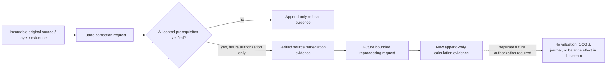

# Disabled Costing Engine Correction and Reprocessing Design

> **Status: Advanced source remediation, reprocessing, successor evidence, valuation consequence, COGS, journal, and balance behavior remains DESIGN ONLY — NOT IMPLEMENTED, NOT ENABLED, AND NOT AUTHORIZED.** The separately documented evidence-only correction request and blocked/rejected human-review control is now implemented; it cannot execute any of these deferred behaviors.
>
> Venture ERP now has an append-only, tenant-scoped correction request and distinct-reviewer `blocked`/`rejected` evidence control, documented in `HUMAN-REVIEWED-CORRECTION-REQUEST-CONTROL-DESIGN.md`. It has no reprocessing command, successor evidence path, background worker, or integration. This document continues to describe the deferred fail-closed reprocessing seam only. Neither document authorizes rewriting source facts, amending a cost layer, revising calculation evidence, restating valuation, calculating COGS, creating/posting a journal, changing a balance, transmitting data, or affecting an external system.

## Purpose and current boundary

The implemented Costing Engine retains immutable receipt-layer snapshots and append-only, hash-chained calculation evidence. A corrected business assertion therefore cannot overwrite an existing layer or calculation. Any future correction design must preserve the original record, identify the exact asserted defect, retain its source/evidence basis, and create a separately traceable successor record only after a separately authorized implementation and review.

| Concern | Current release | Future correction/reprocessing design requirement |
| --- | --- | --- |
| Receipt source facts | Immutable snapshot retained on the inventory movement and layer | Never mutate or reread a different mutable source in place |
| Cost layer | Immutable quantity/value/source/evidence/attribution snapshot | Preserve original layer; link any future successor or refusal by immutable identifiers |
| Calculation evidence | Append-only, hash chained | Preserve predecessor chain; retain correction/refusal reason and exact input/output hashes |
| Allocation and valuation | Evidence-only preview/allocation records | No automatic rerun, reallocation, consumption, valuation adjustment, or COGS output |
| Accounting linkage | Optional traceability link only | Never create, alter, reverse, or post any accounting artifact from correction/reprocessing |
| External action | Absent | Remain prohibited |

> A correction assertion is not an approved source change. An approved source change is not reprocessing authorization. A reprocessed evidence record is not a valuation adjustment or posting authorization.

## Separation of future concepts

Future work must keep source correction, Costing Engine reprocessing, and any eventual financial consequence as distinct, separately authorized controls.

| Future concept | Intended meaning | Immutable relationship | Present availability |
| --- | --- | --- | --- |
| Correction request | A finance-controlled assertion that retained source or configuration evidence is inaccurate or incomplete | Points to an original record hash and retained defect rationale | Implemented as evidence-only request plus blocked/rejected review; no correction/reprocessing |
| Source remediation evidence | Separately governed evidence for a new corrected business assertion | References, but never rewrites, the original source assertion | Unavailable |
| Reprocessing request | A bounded request to recalculate specified Costing Engine evidence from verified immutable inputs | Captures the original evidence identifiers and expected hashes | Unavailable |
| Reprocessed calculation evidence | A new append-only calculation result with a predecessor/supersession relationship | Coexists with the original result; never replaces it | Unavailable |
| Financial correction | Any inventory value, COGS, journal, GL, report, tax, or payment consequence | Requires an independent authorized accounting and policy design | Explicitly excluded |

## Non-negotiable control posture

The future command must fail closed and retain durable refusal evidence whenever it cannot establish every prerequisite from tenant-scoped, immutable, reviewable records. It must not accept free-form replacement quantity, value, currency, weight, volume, unit, allocation driver, policy, account, or posting instruction. It must not infer a missing source fact, convert a unit, select an effective-dated policy, or treat a corrected source assertion as a permission to change historical evidence.



No implementation may use this seam to alter `remainingQuantity`, `remainingValue`, inventory availability, layer source snapshots, allocation output, accounting calculation evidence, journal lines, ledger activity, financial-statement output, or external state.

## Future correction and reprocessing prerequisites

All future checks must be evaluated together in the transaction that appends a correction-request, refusal, or reprocessed-evidence record. The command must read retained snapshots and hashes rather than silently recalculating from mutable operational records.

| Guard | Required proof | Required refusal behavior |
| --- | --- | --- |
| Tenant scope | Original source, layer, evidence, policy, actor, remediation evidence, and request key belong to one active venture | Retain a tenant-scope refusal; create no successor or operational effect |
| Finance authority and segregation | A finance-authorized actor submits; a separately authorized reviewer approves a future reprocessing request | Refuse missing role or invalid reviewer separation |
| Original identity | Exact original record ID, record hash, source hash, input hash, and output hash are retained | Refuse absent, stale, mismatched, or tampered references |
| Chain and invariant integrity | Complete tenant hash chain and independent layer/allocation/measurement invariants verify | Refuse invalid chain or invariant; never repair history in place |
| Defect basis | A bounded rationale and source-remediation evidence identify the alleged incorrect assertion | Refuse unsupported, ambiguous, or free-form replacement data |
| Policy and temporal control | A finance-owned, effective-dated correction/reprocessing policy explicitly authorizes the scenario | Refuse policy ambiguity, retrospective assumption, or unapproved method change |
| Measurement and currency | Retained explicit measures, declared compatible units, source currency, and driver conditions are complete | Refuse missing/incompatible units, implicit conversion, currency mismatch, or inferred value |
| Scope closure | Target layers/evidence are explicitly enumerated and have no unauthorized downstream impact assumption | Refuse open-ended, cross-item, cross-policy, or cross-venture scope |
| Idempotency | One immutable request key maps to at most one accepted successor or durable refusal | Return prior durable result or refuse conflict; never duplicate |
| Consequence boundary | Result is limited to a successor or refusal evidence record under separately approved future scope | Refuse any value/balance/COGS/journal/tax/payroll/payment/filing/integration/external request |

## Future command sketch — deliberately absent

The following is a non-executable vocabulary sketch. It is not present in a router, service, schema, UI, job, or migration.

```ts
type RequestCostingReprocessing = {
  ventureId: number;
  originalCostingCalculationEvidenceId: number;
  originalRecordHash: string;
  originalSourceHash?: string;
  correctionEvidenceReference: string;
  correctionPolicyRevisionId: number;
  targetCostLayerIds: number[];
  idempotencyKey: string;
  rationale: string;
};

type CostingReprocessingResult =
  | {
      outcome: "refused";
      reasonCodes: string[];
      successorEvidenceId: null;
      layerMutated: false;
      financialEffect: false;
    }
  | {
      outcome: "successor_evidence_retained";
      successorEvidenceId: number;
      supersedesRecordHash: string;
      layerMutated: false;
      financialEffect: false;
    };
```

The future command must not accept a journal flag, balance update flag, free-form rate, free-form cost, posting rule, tax selection, payroll input, payment instruction, filing instruction, connector instruction, or external destination.

## Proposed persistence — deliberately absent

If later approved, a new append-only correction/reprocessing evidence table could retain the following fields. No migration is created by this document.

| Field | Purpose |
| --- | --- |
| `ventureId` | Tenant boundary |
| `reprocessingKey` | Venture-scoped idempotency key |
| `originalCostingCalculationEvidenceId` | Original immutable calculation identity |
| `originalRecordHash`, `originalSourceHash` | Exact predecessor integrity proof |
| `correctionPolicyRevisionId` | Finance-owned authorization and temporal scope |
| `correctionEvidenceReference` | Immutable remediation/evidence reference |
| `targetSnapshot` | Explicit immutable layer/evidence target set |
| `outcome`, `reasonCodes` | Durable outcome or refusal explanation |
| `successorCostingCalculationEvidenceId` | Nullable successor evidence link only |
| `recordHash`, `previousRecordHash` | Append-only correction chain integrity |
| `requestedByUserId`, `reviewedByUserId`, `createdAt` | Accountable roles and timestamps |

Future schema work must be additive, subjected to an authorization and data-retention review, generated through the Drizzle migration workflow, inspected for TiDB-safe constraint names, applied only after review, and physically verified. This document does not authorize any schema change.

## Future transactional algorithm

1. Authenticate the caller and resolve active venture membership and finance authorization.
2. Read the original calculation evidence, original cost layers, retained source snapshots, policy revision, linked optional accounting evidence, and any supplied remediation evidence within the same tenant.
3. Verify exact original hashes, the complete tenant chain, independent invariants, policy effective dates, immutable target scope, compatible measurement units, source currency, and no duplicate request key.
4. Verify an independently reviewed, effective-dated correction/reprocessing policy and the required segregation of duties.
5. If any guard fails, append durable refusal evidence that links the immutable original identifiers and returns `layerMutated: false` and `financialEffect: false`.
6. If every guard passes and a later authorization has explicitly enabled the scope, construct a new calculation input snapshot solely from verified retained records and retained remediation evidence.
7. Append a successor calculation-evidence record with explicit supersession/reference semantics; never update the original record, layer, source snapshot, or chain link.
8. Stop. Any valuation adjustment, COGS recognition, journal proposal, journal creation/posting, balance change, report restatement, tax/payroll result, payment, filing, integration, or external transmission requires a separate bounded design and authorization.

## Explicit exclusions and deferred decisions

| Deferred area | Why it remains excluded |
| --- | --- |
| Editing or deleting historical layers/evidence | Violates the current immutable-evidence architecture |
| Retrospective valuation or inventory restatement | Requires accounting policy, period-close, valuation, and reconciliation governance |
| COGS, margin, profitability, and formal statement changes | Not available in the current evidence-only Costing Engine foundation |
| Journal proposal, journal, GL, or balance adjustments | Requires separate accounting-control authorization and reconciliation design |
| Quantity/on-hand/reservation changes | Belong to the operational inventory correction domain, not Costing Engine evidence |
| Measurement conversion or equivalence | Requires separately governed canonical conversion evidence and policy |
| Standard cost, lot/serial, manufacturing, project/service, asset, or investment calculations | Require separately authorized domain designs and canonical inputs |
| Tax, payroll, payment, filing, integration, or external transmission | Remain prohibited; payroll also remains blocked pending qualified Indonesian reviewer evidence |

## Adoption evidence required before implementation

No correction or reprocessing code should be written until a later authorization explicitly approves the scope and all of the following evidence is available.

1. Finance governance approves correction taxonomy, temporal treatment, materiality, source-remediation ownership, retention, and segregation-of-duties policy.
2. A reviewed data contract defines original/successor/refusal relationships, request idempotency, hash-chain behavior, evidence retention, and correction-policy effective dates.
3. A separately approved design defines any downstream inventory valuation, COGS, accounting, reporting, or period-close consequence rather than assuming one.
4. Schema review confirms an additive migration, TiDB-safe constraint names, unique indexes, and safe deployment/rollback posture.
5. Unit, router, and real typed-route integration tests prove each refusal class, duplicate behavior, cross-tenant denial, immutable original preservation, complete chain validation, and no financial/external effect.
6. Desktop and mobile UX review shows an unambiguous **Evidence-only correction/reprocessing request** boundary with no edit-in-place, valuation, COGS, posting, payment, filing, or integration action.
7. Explicit follow-on authorization approves implementation after finance control owners review the design and test plan.

Until then, the Costing Engine remains an evidence-only foundation. This document creates no executable route, schema, migration, job, UI control, correction, reprocessing, valuation, COGS, journal, posting authority, financial-statement change, tax/payroll result, payment, filing, integration, or external effect.
