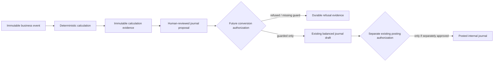

# Disabled Proposal-to-Journal Conversion Design

> **Status: DESIGN ONLY — NOT IMPLEMENTED, NOT ENABLED, NOT AUTHORIZED FOR POSTING.**
>
> Venture ERP currently has **no** service, typed contract, user-interface action, database migration, or workflow that converts a journal proposal into a journal. This document preserves a future control design only. It must not be interpreted as authorization to create, number, post, reverse, transmit, or report a journal.

## Purpose

The implemented accounting-control path is intentionally bounded:

```text
Business event → immutable event snapshot → deterministic calculation → immutable evidence → human-reviewed proposal
```

The future conversion seam would be a separate, explicitly authorized stage after proposal review. It must remain downstream of immutable evidence and must never bypass tenant scope, finance authorization, open-period checks, balanced-journal validation, source/rule linkage, or the existing journal authority.

| Boundary | Current release | Future design requirement |
|---|---|---|
| Calculation evidence | Implemented as append-only evidence with hash-chain verification | Required before conversion is considered |
| Proposal review | Implemented as approve/reject only | Must be a necessary but insufficient prerequisite |
| Conversion action | Absent | A separate finance-authorized command, if later approved |
| Journal draft creation | Existing manual finance control only | Must use the same guarded journal service, never direct SQL |
| Journal posting | Existing separately guarded action | Must remain a separate action; conversion never posts |
| External effects | Absent | Remain prohibited by conversion |

## Non-negotiable control posture

Conversion must fail closed. The system must create **no journal** when any prerequisite cannot be established from retained evidence. It must not default an account, dimension, currency, period, amount, reviewer, rule revision, or source record.

> A proposal approval is not posting authorization. A calculation record is not accounting approval. A converted journal draft is not a posted journal.

The future workflow remains deliberately separated:



No implementation may connect `D` directly to `I`.

## Future conversion prerequisites

All checks must be evaluated together, in the same database transaction that would create a journal draft. The conversion command must read immutable proposal and calculation-evidence snapshots rather than recalculate from mutable source records.

| Guard | Required proof | Refusal behavior |
|---|---|---|
| Tenant scope | Proposal, evidence, journal period, accounts, source event, actor membership, and journal all belong to one active venture | Refuse with tenant-scope reason; no journal |
| Finance authority | Actor holds an explicit finance-authorized venture role | Refuse with authorization reason; no journal |
| Proposal state | Proposal is approved and has no prior conversion linkage | Refuse duplicate, pending, rejected, or expired proposal |
| Evidence integrity | Evidence record chain verifies; input/output/record hashes and independent invariants are valid | Refuse tamper or invariant evidence |
| Rule linkage | Proposal retains one approved rule revision matching retained evidence | Refuse missing, mismatched, retired, or ambiguous linkage |
| Period control | Retained proposal period is open at conversion time | Refuse closed/missing period |
| Account control | Every proposal account remains an active chart-of-accounts master in the venture | Refuse inactive, missing, or cross-tenant account |
| Currency control | One retained journal currency layer is balanced; no implicit FX or reporting conversion | Refuse mixed/unsupported currency conditions |
| Amount control | Reconstructed journal lines equal immutable proposal lines to exact cents | Refuse any difference, rounding drift, or missing line |
| Dimension control | Required frozen dimensions are present and retained as proposal context | Refuse missing or changed dimension context |
| Idempotency | One conversion request key maps to at most one journal draft | Return existing durable result or refuse conflict; never duplicate |

## Proposed command shape — deliberately absent

The following is a **non-executable contract sketch**. It is not present in the tRPC router, service, or user interface.

```ts
type ConvertApprovedProposalRequest = {
  ventureId: number;
  journalProposalId: number;
  expectedProposalSnapshotHash: string;
  expectedCalculationRecordHash: string;
  idempotencyKey: string;
  rationale: string;
};

type ConvertApprovedProposalResult =
  | {
      outcome: "converted_to_draft";
      journalId: number;
      journalNumber: string;
      journalProposalId: number;
      conversionEvidenceId: number;
      posted: false;
    }
  | {
      outcome: "refused";
      reasonCodes: string[];
      journalCreated: false;
    };
```

The command must not accept free-form journal lines, account IDs, amounts, currencies, dimension values, or a posting flag. Those values would be reconstructed from the immutable approved proposal snapshot only.

## Proposed persistence — deliberately absent

If separately authorized, an additive migration could introduce a conversion-evidence table with immutable fields such as:

| Field | Purpose |
|---|---|
| `ventureId` | Tenant boundary |
| `journalProposalId` | One approved proposal source |
| `calculationEvidenceId` | Verified immutable calculation source |
| `conversionKey` | Idempotency key scoped to the venture |
| `proposalSnapshotHash` | Exact approved proposal input proof |
| `calculationRecordHash` | Exact calculation-evidence proof |
| `outcome` | `converted_to_draft` or `refused` only |
| `reasonCodes` | Durable refusal/explanation evidence |
| `journalId` | Nullable draft journal linkage only; never a posting reference |
| `convertedByUserId`, `convertedAt` | Accountable actor and timestamp |
| `recordHash`, `previousRecordHash` | Optional append-only conversion evidence chain |

Suggested uniqueness constraints would include `(ventureId, journalProposalId)` and `(ventureId, conversionKey)`. A physical migration must not be generated or applied without separate authorization, a schema review, TiDB-safe constraint-name inspection, and an approved test plan.

## Transactional algorithm — future only

1. Authenticate the caller and resolve active venture membership.
2. Lock or otherwise serialize access to the specific approved proposal and its conversion key.
3. Read the proposal, referenced immutable calculation evidence, frozen event snapshot, rule revision snapshot, period, and account masters from the same venture.
4. Verify evidence hashes, predecessor chain, independent invariants, proposal status, retained line hash, exact cents, currency, dimension context, and open-period state.
5. If a prior successful conversion exists for the same idempotency key or proposal, return its durable draft result without creating another journal.
6. If any guard fails, append refusal evidence and return `journalCreated: false`.
7. Only if every guard passes, invoke the existing guarded journal-draft service with reconstructed immutable lines and retained period/currency/narrative context.
8. Append conversion evidence linking proposal, calculation evidence, and journal draft. The journal remains **draft**.
9. Require a separate existing posting command and its own period, balance, and authorization checks to post.

The future algorithm must not call payment, tax, payroll, filing, integration, notification, workflow, or external-transmission services.

## Explicitly deferred decisions

The following decisions remain outside this design and require separate finance governance before any implementation:

| Deferred area | Why it is excluded |
|---|---|
| Automatic conversion | Removes human control and creates unsafe coupling |
| Batch or proposal-set conversion | Requires ordering, isolation, and partial-failure policy |
| Reversal/correction journals | Requires immutable correction and accounting-period policy |
| Foreign-currency conversion | Requires approved FX, reporting, and remeasurement policy |
| Inventory valuation, COGS, landed cost | Requires explicit costing-source and valuation governance |
| Tax, withholding, payroll, statutory reporting | Jurisdiction-specific and remains blocked by qualified review gates |
| Payment execution and bank connectivity | Separate payment-safety and provider authorization controls |
| External journal/GL transmission | Requires connector governance, credential review, and explicit authorization |

## Adoption evidence required before implementation

No conversion code should be written until a later authorization explicitly approves this scope and the following evidence exists:

1. Finance governance approves the exact transition model, actor roles, segregation-of-duties policy, and reversal policy.
2. A reviewed data contract defines immutable proposal snapshot hashes, calculation-evidence linkage, journal-draft idempotency, and failure evidence.
3. A migration review confirms additive schema, short database constraint identifiers, unique constraints, and safe deployment behavior.
4. Unit, router, and real typed-route integration tests prove successful guarded draft creation, duplicate idempotency, each refusal class, cross-tenant denial, unchanged balances before posting, and no external effects.
5. Desktop and mobile UI review demonstrates an unambiguous **Create controlled draft only** boundary with no post button on the conversion action.
6. A separate authorization approves implementation after the design, test plan, and control owners have been reviewed.

Until then, the implemented system stops at immutable evidence and human-reviewed journal proposals. This document creates no executable route, schema, migration, journal, posting authority, or external effect.
