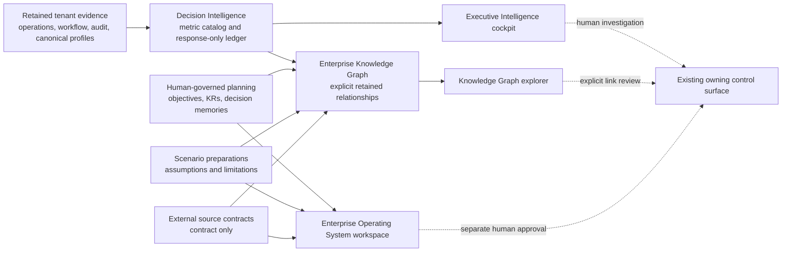

# Enterprise Operating System Intelligence Design

**Status:** Implemented foundation, version `0.1-human-governed`  
**Scope:** Tenant-scoped planning, evidence, relationship discovery, and readiness controls  
**Effective implementation date:** 2026-08-27

## Purpose and design position

Venture ERP treats intelligence as an **evidence and decision-preparation system**, not an autonomous corporate control system. The implementation joins the existing governed metric catalog, executive evidence cockpit, canonical evidence bridges, workflow/audit records, strategic planning records, and evidence links. It makes both present evidence and missing prerequisites visible so that a human can investigate a question with its source context.

> A visible graph, metric, objective, scenario, source contract, priority signal, or approval state is **not** an assertion of causality, a forecast, a recommendation, a decision, a financial calculation, or an external action.

## Implemented architecture

The dashed paths are deliberately **not system actions**. Existing operational modules retain their own authorization and lifecycle controls.

## Persistent model and control lifecycle

The additive `0027_milky_timeslip.sql` migration adds tenant-scoped records. Each record carries venture scope, auditable creator attribution, dates, lifecycle state, and a narrow role boundary. No table stores forecast values, simulations, calculated valuation, payroll determination, payment instructions, journals, or integration credentials.

| Record | Purpose | Creation posture | Review gate | Prohibited interpretation |
| --- | --- | --- | --- | --- |
| `eos_strategic_objectives` | Retains a time-bounded strategic objective and evidence requirement. | Authorized leader creates **draft**. | A different authorized leader activates a draft or paused objective. | Progress, success, capital allocation, or execution. |
| `eos_key_results` | Associates a stated result/target with an objective and optional governed metric key. | Authorized leader creates **draft**. | Authorized leader may explicitly set a lifecycle state. | A computed performance result or automatic objective scoring. |
| `eos_decision_memories` | Preserves decision statement, alternatives, assumptions, risks, expected/actual outcomes, and lessons. | Authorized leader creates **draft**. | A different authorized leader approves; only an approved memory accepts outcome learning. | Decision selection, approval of a real-world action, or authority to execute. |
| `eos_scenario_preparations` | Captures a future strategic/risk/opportunity/portfolio/operating-plan question, assumptions, evidence requirement, and limitations. | Authorized leader creates **draft**. | A different authorized leader approves the review artifact. | Scenario calculation, forecast, sensitivity analysis, or recommendation. |
| `eos_external_source_contracts` | Records the intended source category, data classification, collection mode, refresh expectation, ownership, evidence requirement, and boundary. | Authorized leader creates **draft**. | A different authorized leader approves the **contract**, not a connection. | Connector activation, API call, data collection, transmission, or source reliability. |
| `eos_evidence_links` | Retains an explicit reference between a planning target and a metric, canonical object, operational record, workflow, audit event, governance decision, source contract, or human assertion. | Authorized leader creates a labeled link. | No implicit validation is asserted; posture remains retained, declared, missing, or requires review. | Proof that an unverified reference exists, is complete, or supports causality. |

## Metric governance and evidence ledger

The Decision Intelligence catalog contains **219 governed definitions**. Each definition includes a stable key, source-code version, effective date, owner, question, formula statement, time grain, required evidence, lineage, quality posture, freshness posture, readiness, and a structured collection plan. The request-time metric evidence ledger does not persist metric truth; it exposes the immediate evaluation response only.

| Metric state | Meaning | Value behavior | Required next step |
| --- | --- | --- | --- |
| `observed` | The declared formula can use retained tenant-scoped source rows. | Returns only a bounded current value, source counts, formula, and limitation. | Review source lineage and quality posture. |
| `partially_supported` | Some context exists but the required metric contract is incomplete. | Does not estimate a value. | Implement the stated internal model, source fields, events, and validation gate. |
| `not_modeled` | No approved formula/source contract is represented. | Does not estimate a value. | Obtain/define a versioned source contract and formula. |
| `blocked` | A policy, evidence, or governance prerequisite prevents calculation. | Does not estimate a value. | Satisfy the stated human governance or evidence prerequisite. |

Freshness uses an evaluator timestamp rather than fabricating a source-data SLA. Source-record freshness remains `not modeled` unless a specific metric source contract models it. Quality checks verify tenant scope, request-time retained evidence usage, and explicitly disclosed limitations; they do not certify accounting, legal, statutory, tax, payroll, operational, security, or investment correctness.

## Enterprise Knowledge Graph

The graph is a tenant-scoped, response-only projection. It includes metric definitions, metric evidence-source nodes, canonical resources and suppliers, operational records, inventory movements, workflow definitions/instances/tasks, audit events, governance cases, strategic objectives, key results, decision memories, scenario preparations, external source contracts, and explicit evidence links.

An edge appears only if an existing retained relationship supports it: for example an operational-record reference, workflow foreign key, audit reference, key-result objective ID, decision-memory governance-case ID, or an evidence-link target. A declared metric key is shown as a reference; a user-entered evidence reference is connected only when it exactly equals an existing graph node identifier. A missing relationship is absent rather than inferred.

## External intelligence and AI-copilot readiness

The current platform implements **readiness contracts, not collection or a copilot**. The Operating System workspace exposes source availability for the Knowledge Graph, metric catalog, planning records, external source contracts, and blocked scenario/forecast calculation. The readiness view explains that no model invocation, external source reading, connector call, refresh job, prediction, recommendation, decision, or action occurs.

| Future capability | Current state | Required before separate implementation may be considered |
| --- | --- | --- |
| Market/competitor/regulatory/economic intelligence | Source-contract records can be drafted and separately approved. | Per-source authorization, legal/terms review, data classification, provider/connector selection, versioned retrieval contract, retention policy, human review, and focused tests. |
| AI copilot | No Enterprise Operating System model call exists. | Tenant-scoped retrieval policy, source access approvals, prompt/output/evaluation versioning, privacy review, human escalation, no-action tool boundary, and independent quality/security validation. |
| Predictive or scenario calculation | Scenario preparations are retained; calculation is blocked. | Governed historical series, documented formula/model, time-window and identity policy, uncertainty/evaluation method, approval, reproducibility evidence, and separate authorization. |
| Recommendations or decisions | Deterministic priority signals and planning artifacts remain human review aids. | Explicit decision policy, accountable approver, explainability/evidence standard, impact assessment, and separately authorized execution path. |

## Safe operating flow

1. Select the active venture. Every read and write is scoped by active tenant membership.
2. Use **Enterprise Intelligence** to inspect metric definition, evidence ledger, quality/freshness, readiness, and implementation plan.
3. Use **Knowledge Graph** to follow an explicit relationship to retained evidence. Do not treat a graph edge as causality.
4. Use **Enterprise Operating System** to draft a planning artifact from real authorized context; write assumptions and limitations plainly.
5. Attach only explicit evidence references. Label human assertions as such, and leave unknown facts missing.
6. Obtain a separate authorized human approval where the lifecycle requires it. Approval of a source contract or scenario artifact never activates collection, calculation, or action.
7. Return to the owning operational module for any separately authorized activity. The intelligence layer does not execute that activity.

## Non-negotiable exclusions

The integrated program does **not** create or alter inventory balances/movements, invoice/payment records, valuation, cost, COGS, journal proposals, journals, general ledger entries, financial statements, tax, payroll, statutory filings, employee compensation, payments, cash movement, external integrations, external transmissions, autonomous action, forecasts, scenario calculations, causal claims, recommendations, or formal professional advice.

The Indonesian payroll evidence pack remains draft-only, inactive, unreviewed, unselected, and blocked. No payroll calculation, rehearsal, activation, production use, compliance assertion, payment, or filing becomes available unless a qualified Indonesian payroll/tax reviewer provides written, effective-dated approval identifying source versions, worker scope, cadence, limitations, and explicit authorization.

## Validation and rollout gates

This implementation must remain covered by TypeScript checks, focused router tests, real lifecycle tests, contract validation, foundation verification, production build, and desktop/mobile review. Future capabilities must add their own additive schema review, reviewed TiDB-safe migration, physical schema verification, tenant-isolation/no-effect tests, source-specific quality checks, and clear documentation before a state transition from readiness to implementation.
