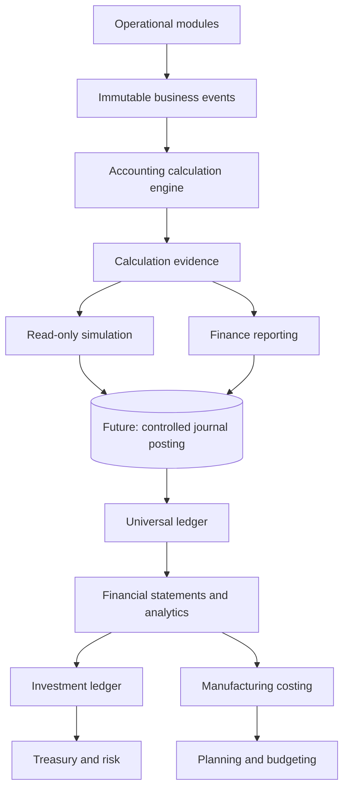

# Enterprise Finance and Operations Research Roadmap

**Source:** User-supplied planning notes, preserved from `pasted_content_9.txt` on 2026-08-26.  
**Status:** **Research and prioritization input; not an implementation authorization, accounting policy, compliance opinion, or production-readiness claim.**

## Research conclusion

The supplied roadmap recommends continuing non-payroll ERP evolution rather than waiting on the Indonesian payroll reviewer. It prioritizes a transition from the current service-aligned operational control plane toward an institutional finance and enterprise-operations platform. The core proposed sequence is inventory valuation and cost accounting, COGS/margins, fixed assets, treasury, an Investment Book of Record (IBOR), enterprise reporting, budgeting, manufacturing, supply chain, and a canonical-evidence AI finance copilot.

This is directionally compatible with Venture ERP’s existing immutable source-event, deterministic calculation-evidence, finance-owned rule, account-classification, reporting-readiness, and source-fact foundations. It does **not** override their safety boundaries. In particular, the current implementation must not calculate valuation/COGS, recognize revenue, capitalize/depreciate assets, calculate investments, create/post journals through the control engine, mutate GL balances, determine tax/payroll, execute payments, file, transmit, or represent statutory/financial-statement readiness without separately approved scope, policy, evidence, tests, and professional review where required.

> The user’s notes correctly preserve payroll as a separate reviewer-gated consumer of the same evidence architecture. The Indonesian payroll pack remains draft, unreviewed, inactive, unselected, and non-calculating until written, effective-dated approval from a qualified Indonesian payroll/tax reviewer is supplied.

## Recommended phased roadmap

| Phase | Proposed capability set | Required control posture before implementation |
| --- | --- | --- |
| **1. Inventory valuation and cost accounting** | Effective-dated finance-owned valuation policies; FIFO, LIFO, moving average, weighted average, standard cost, specific identification; immutable receipt/issue layers; remaining quantity/value; acquisition, warehouse, lot, serial, supplier, and FX context; landed-cost allocation by quantity, weight, value, volume, or finance-approved manual driver; cost/profit centers, internal orders, activity/overhead/manufacturing pools. | New bounded context, immutable inventory-layer evidence, approved effective-dated policy revisions, no historical rewrite, explicit currency/FX evidence, independent invariants, and no posting activation. |
| **2. COGS and margin** | Deterministic COGS, gross profit, contribution margin, product/customer/project margin, each traceable through inventory layers, valuation rule, calculation evidence, and future journal proposal. | Cannot begin until Phase 1 produces canonical layer and valuation evidence; no revenue/COGS journal or financial statement claim until separately authorized. |
| **3. Fixed assets** | Capitalization policies, asset classes, component assets, useful life, residual value, depreciation methods, revaluation, impairment, disposal, transfer, maintenance capitalization. | Existing asset acquisition source facts are not recognition evidence. Require distinct asset events, governed valuation/depreciation policy, availability/ownership evidence, effective dates, reviewer gates, and posting remains disabled. |
| **4. Treasury** | Cash management, bank accounts, liquidity, forecasts, FX-rate history/revaluation, intercompany cash, bank reconciliation, disabled payment proposals. | No live banking or payment execution. Require account ownership, reconciliation evidence, FX policy, cash forecasting evidence, human approval, and a separately authorized integration boundary. |
| **5. Investment Book of Record (IBOR)** | Positions, holdings, lots, acquisition history, lifecycle, FIFO/LIFO/HIFO/LOFO/average/specific cost basis, corporate actions, daily/monthly P&L, TWR, MWR, IRR/XIRR, attribution, benchmarks, and eventual VaR/beta/alpha/Sharpe/Sortino/tracking error. | Design and source/evidence architecture only until authoritative market, corporate-action, position, valuation, and policy data are governed; no investment calculation, trading, custody, or external integration. |
| **6. Enterprise reporting** | Trial Balance, GL, Balance Sheet, Income Statement, Cash Flow, consolidation, segment/dimension reporting, multi-company and intercompany eliminations. | Existing reporting is controlled activity, not posted GL or formal statements. Require formal statement policy, frozen classifications, opening/closing balance evidence, reconciliation, consolidation, translation, and statement-specific invariant evidence. |
| **7. Budgeting** | Budget, forecast, scenarios, rolling forecast, variance, commitments, encumbrances, public/private budgets. | Require versioned approved budget models, ownership, period and FX policy, public-sector jurisdiction gates, and explicit no-filing/no-payment safeguards. |
| **8. Manufacturing** | BOM, routing, work centers, production orders, MRP, capacity planning, scrap, yield, variance. | Only after costing has canonical policy/evidence; require product/master stewardship, material/production source events, and no inferred valuation. |
| **9. Supply chain** | Demand planning, vendor performance, lead-time/procurement analytics, warehouse KPIs, transportation, distribution. | Require attributable operational source data, data-quality rules, planning policy, and no external logistics execution without a separately governed integration. |
| **10. AI finance copilot** | Evidence-bounded explanations such as inventory movement causes, drill-through from retained reporting activity to GL/evidence/layers/receipt/PO/approval/audit. | Read-only, tenant-scoped retrieval over canonical evidence only; disclose missing evidence, never guess, post, approve, or act. Requires the existing AI governance control boundary. |

## Cross-cutting research themes

| Theme | Proposed research content | Governed interpretation for Venture ERP |
| --- | --- | --- |
| **Financial warehouse / semantic layer** | Star-schema facts/dimensions, slowly changing finance dimensions, time-travel reporting, materialized aggregates with evidence drill-through. | A future read-model projection. It must preserve tenant isolation, canonical source links, versioned dimension context, as-of semantics, and explicit freshness/rebuild evidence. |
| **Enterprise close and consolidation** | Close checklists, close tasks, multi-venture/legal-entity consolidation, currency translation/CTA, intercompany matching/eliminations, disclosures. | Requires legal-entity model, formal close policy, translation source/policy, matching/elimination evidence, and professional governance; current close controls are not consolidation. |
| **Revenue recognition** | Point-in-time, over-time, milestone recognition, deferred revenue, contract liabilities. | A future dedicated policy/evidence engine. Internal sales fulfillment is not revenue recognition, shipment proof, billing, collection, or accounting event. |
| **Tax architecture** | Configurable tax engines, jurisdiction abstraction, VAT/GST and withholding frameworks, evidence/approval gates, country-pack activation after qualified review. | Separate determination from posting. Country packs remain inactive until qualified review; no tax calculation, filing, or external transmission is authorized. |
| **Data governance and MDM** | Golden records, duplicate detection, stewardship, reference-data versioning, glossary, lineage. | Strong candidate foundation work. Must remain tenant-scoped, reviewable, and avoid inferring source truth from matches. |
| **Performance and scalability** | Event replay, snapshots, read models, idempotency, outbox/inbox, exactly-once semantics where practical. | Aligns with the service-aligned modular-monolith evolution. Introduce only when measurable scale, reliability, team, or integration signals justify the complexity. |

## Long-term architecture from the supplied notes

The diagram is a **target architecture**, not a statement of implemented modules. In the current codebase, operational source controls, procurement receipt accounting events, calculation evidence, controlled reporting, finance classifications/readiness, and source-fact capture exist in bounded form. Future posting, universal ledger, formal statements, valuation/costing, IBOR, treasury/risk, manufacturing costing, and planning/budgeting remain gated work.

## Delivery sequencing and decision gates

1. Preserve this roadmap as planning input and maintain the payroll review block.
2. Before any Phase 1 calculation work, perform a finance architecture decision comparing valuation-policy scope, source evidence, calculation invariant requirements, correction/reprocessing, cost/benefit, and operational ownership.
3. Implement one bounded, testable policy/evidence foundation at a time. Each increment must retain source snapshots, effective-dated policy revision, deterministic result/refusal evidence, tenant and role controls, and no hidden balance mutation.
4. Expand reporting only from completed immutable calculation evidence; do not introduce a competing calculator or promote activity views to formal statements.
5. Introduce integration, data warehouse, outbox, or service-extraction infrastructure only when a measurable ownership, scale, reliability, compliance, or release-independence signal justifies it.

## Provenance and limitations

This document organizes the user’s supplied roadmap. It is **not external research**, and no claim in it has been independently validated against an accounting standard, financial regulator, tax authority, market-data source, bank, custodian, or qualified professional. Any consequential accounting, tax, payroll, investment, treasury, or statutory reporting decision requires separately authorized research and qualified professional review.

> I’m an AI, not a tax professional — verify anything consequential with a CPA or tax professional before filing.
